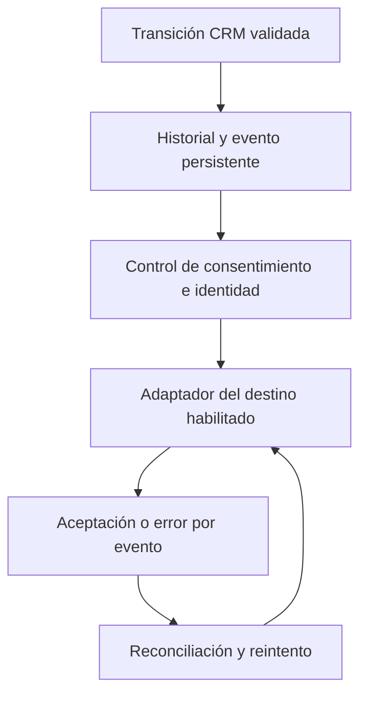

# Measurement Specification

Actualización 10/10/2026: decisiones confirmadas y alcance en `decisions.md`. La confirmación es parcial; no convierte otros pendientes en aprobaciones ni acredita una implementación.

Proyecto: AnalyticsXXXXX — José Cubillo · Digital Analytics & Tracking.
Versión: 1.0, 7 de octubre de 2026 (America/Santiago).
Estado: contrato de medición propuesto para Codex; no implementación verificada.

Fuentes: `strategy.md`, `product.md`, `wireframe.md`, `content.md`, `design.md`, leídos para esta entrega. Conserva landing `/`, `/privacidad`, FAQ visible, CTA único “Solicitar diagnóstico inicial” y formulario `diagnosis_request`. Leer junto con `technical.md`. Frecuencia de form_start confirmada el 10/10/2026: una vez por instancia montada, sin repetir por reintento. El resto de naming, límites y retenciones técnicas conserva su estado propuesto salvo otra decisión explícita. No definir nuevos objetivos comerciales ni atribuir mejoras de campañas sin evidencia.

## Measurement Objectives

Responder: ¿qué ubicaciones llevan a la solicitud?, ¿dónde se interrumpe el formulario?, ¿qué solicitudes quedan realmente recibidas?, ¿cuáles tienen encaje y llegan a conversación, propuesta y venta?, ¿qué origen permitido podemos relacionar con esos resultados?

| Indicador | Fuente y definición |
| --- | --- |
| Leads recibidos | Conteo único de lead_id en DB, excluyendo pruebas/spam confirmado; fuente de verdad operativa |
| Leads observados en GA4 | `generate_lead` bajo consentimiento; puede ser menor que DB por preferencias/bloqueadores/red |
| Inicio→recepción | Usuarios/sesiones con form_start y generate_lead dentro de un alcance temporal definido; no dividir eventos brutos como si fueran personas únicas |
| Intentos→recepción | form_submit y recepción observados, con definición de intento; reintento no equivale a nuevo lead |
| Encaje, propuestas y ganados | Historial comercial; tasas con denominador y cohorte de leads explícitos |
| Campaña→resultado | Join por lead_id con adquisición permitida y estados; atribución descriptiva, no efecto causal |

No metas ni porcentajes de ahorro inventados. GA4 no sustituye el registro operativo. No convertir el clic ni el submit en conversión comercial. Sin gasto publicitario/campañas activas no hay CPA/ROAS válido; no crear panel simulado.

## Architecture

Aplicación emite objetos tipados → dataLayer → GTM (triggers de Custom Event) → GA4. Google tag y eventos administrados en GTM; no segundo snippet/config en app. App posee consentimiento y eventos semánticos. Backend posee recepción y registro del lead. CRM posee avance comercial cuando se conecte.

GTM se carga una vez tras aceptar analytics o una categoría publicitaria habilitada; antes, ningún contenedor/Google tag de medición ni eventos analíticos. Política **basic/opt-in**, sin pings sin cookies por defecto. CMP o controles first-party deben entregar estados antes de cargar GTM. Cargar contenedor no habilita automáticamente todos sus tags: filtrar cada destino por finalidad.

`site_page_view` interno controla page_view de GA4. Configurar Google tag `send_page_view=false`, desactivar medición automática de cambios de historial y formulario en Enhanced Measurement. Emitir una page_view inicial cuando el tag esté listo y consentido; al navegar `/`↔`/privacidad`, una por pathname. Cambios de hash a secciones no emiten page_view. Next Router no implica medir cada render. No duplicar con History trigger, Initialization o otro plugin.

Página actual tras aceptación es la única page_view de ese momento: no replay de páginas o acciones anteriores a consentimiento. Acquisition puede usar URL actual tras consentir. No mezclar generate_lead browser y MP del servidor: v1 usa browser exclusivamente y DB para reconciliación. Lead real puede existir sin evento GA4.

Fases:

| Fase | Alcance |
| --- | --- |
| Lanzamiento | GA4/GTM consentidos, eventos mínimos, DB privada, adquisición permitida, aviso y seguimiento manual |
| Con CRM real | Upsert por lead_id, IDs externos, historial firmado y reconciliación |
| Con campañas activas | Destinos Ads/Meta/TikTok y conversiones offline evaluadas individualmente; consentimiento y pruebas por plataforma |

No instalar píxeles, CAPI, server-side GTM ni BQ solo para ejemplificar capacidades vendidas.

## dataLayer Convention

Inicializar una vez: `window.dataLayer = window.dataLayer || []`; comprobar `Array.isArray` en QA. Nunca reemplazarlo tras cargar GTM. Función única `track()` con TypeScript union discriminada por evento, allowlist de parámetros y gate de consentimiento. Fallos de medición se capturan sin bloquear UI y sin registrar datos privados.

Nombres/valores controlados en minúsculas, snake_case, sin tildes. Labels de interfaz mantienen español; no se envían como texto libre. Schema explícito `measurement_version: '1'`. Omitir parámetros no aplicables en transporte GA4. Para evitar valores heredados por el modelo persistente de GTM, cada push incluye `null` para parámetros específicos no aplicables y mapper los omite; GTM toma solo el contrato de ese evento, nunca todo dataLayer.

```ts
// Solo después de recepción confirmada y analytics consentido.
window.dataLayer.push({
  event: 'generate_lead',
  measurement_version: '1',
  page_type: 'landing',
  form_id: 'diagnosis_request',
  lead_type: 'diagnosis_request',
  cta_id: null,
  cta_location: null,
  target_id: null,
  attempt_type: null,
  error_type: null,
  field_name: null,
  error_code: null,
  lead_id: 'uuid-aleatorio-del-servidor'
});
```

Lead ID es seudónimo vinculable al registro privado: acceso restringido, nunca derivado de email. dataLayer no contiene contacto, inversión, CRM escrito, problema, dominio de la empresa enviada, hashes de email, IDs de clicks ni GA client/session ID. Esos datos permitidos viajan al backend por canales específicos, no en eventos de analytics. Consent snapshot tampoco contiene contacto.

## Event Dictionary

| Evento | Decisión | Momento exacto / trigger conceptual | Frecuencia / conversión |
| --- | --- | --- | --- |
| `page_view` | Incluir base GA4 | Tag GA4 desde `site_page_view`, Google tag configurado y consentimiento vigente | Una por navegación de pathname; no hash; no key event |
| `click_to_action` | Incluir | Activación de enlace comercial a #diagnostico; Custom Event del mismo nombre | Una por activación mouse/teclado; no key event |
| `form_start` | Incluir | Primer cambio real de un campo, input/change (no foco, vista ni click CTA) | Una por instancia de formulario montada; no por reintento; no key event |
| `form_error` | Incluir | Bloqueo de submit o respuesta explícita inválida/fallo/rate limit, o timeout incierto | Un resumen por intento con error; no por tecla/render; no key event |
| `form_submit` | Incluir diagnóstico | Validación cliente pasó e inmediatamente antes de POST | Una por petición iniciada, `initial/retry`; no key event |
| `generate_lead` | Incluir conversión | Respuesta 201/200 accepted con lead_id válido tras commit | Una por lead_id en vida de la página; única key event del formulario |
| `service_view` | Excluir v1 | Capacidades estáticas sin páginas de servicio; una impresión no aporta una decisión necesaria | No trigger de visibilidad |
| `faq_interaction` | Excluir v1 | Respuestas visibles, sin control interactivo | No inventar click/expansión |

`site_page_view` es evento de integración, no enviar también a GA4 con ese nombre. Consent update es control de plataforma, no KPI comercial. Scroll genérico opcional de Enhanced Measurement no es conversión y no requiere nuevas secciones; mantener desactivado por defecto hasta una pregunta concreta.

## Event Parameters

| Parámetro | Valores / uso | Destino |
| --- | --- | --- |
| `measurement_version` | `'1'`, todos eventos de aplicación | GA4; no dimensión necesaria |
| `page_type` | `landing`, `privacy`, `not_found` | GA4; dimensión opcional útil |
| `cta_id` | `request_diagnosis` | Solo click_to_action |
| `cta_location` | `header`, `hero`, `solution`, `experience`, `mobile_bar` | Solo click_to_action; dimensión de evento |
| `target_id` | `diagnostico` | Solo click_to_action |
| `form_id` | `diagnosis_request` | Todos eventos de formulario |
| `attempt_type` | `initial`, `retry` | Solo form_submit |
| `error_type` | `validation`, `reception`, `rate_limit`, `uncertain` | Solo form_error; dimensión de evento |
| `field_name` | `name`, `email`, `website`, `organization_type`, `ad_spend_context`, `crm_context`, `problem`, `multiple`, `none` | Solo form_error; jamás valor |
| `error_code` | `required`, `invalid_format`, `too_long`, `multiple_invalid`, `unavailable`, `timeout`, `rate_limited`, `conflict`, `blocked`, `invalid_request` | Solo form_error, catálogo cerrado |
| `lead_type` | `diagnosis_request` | Solo generate_lead |
| `lead_id` | UUID backend | generate_lead; no dimensión personalizada de alta cardinalidad ni user_id |

No `value`/`currency` en generate_lead hasta que exista valoración económica justificada; lead ≠ venta. Registrar dimensiones personalizadas solo para reportes concretos, inicialmente cta_location/error_type/field_name si necesarias. No registrar client_id, session_id, request_id o lead_id como dimensiones de interfaz. Exportación BQ puede añadirse si se necesita join por lead_id y existen volumen/costos/accesos acordados.

Para page_view usar `page_location` saneada: dominio propio + pathname + solo UTMs de campañas conocidas/validadas; eliminar hash, otros queries y click IDs. `page_referrer` solo origin sin query/path. El Google tag debe recibir ubicación/referrer saneados en config antes de enviar cualquier evento. No dejar auto pageview previo con URL cruda. UTMs desconocidas se omiten de GA4 para reducir riesgo de PII; adquisición backend obedece la misma política de valores permitidos. Nunca imponer lower-case a click IDs o al ID GA.

## CTA Tracking

Instrumentar atributos semánticos `data-cta-id=request_diagnosis`, `data-cta-location` según ubicación y href nativo `#diagnostico`. Elegir un único mecanismo: componente enlace con callback de aplicación; sin segundo trigger Click de GTM ni handler delegado que lo duplique.

Mouse, teclado y tecnología asistiva generan una activación, no eventos en focus/mousedown/scroll. Navegación continúa aunque GTM falle. Submit usa el mismo copy pero **no** es click_to_action: form_submit diferencia operación de navegación. Menú, privacidad, email de soporte y identidad no son CTA comercial. No propagar medición por texto del DOM.

`last_cta_location` puede mantenerse en memoria para contexto de lead; null si llega directo a formulario. No asumir hero cuando no hubo clic. Se ignora o elimina al revocar analytics y no condiciona recepción.

## Form Tracking

1. Edición real → form_start una vez por instancia montada (confirmado por José el 10/10/2026). Los reintentos no reinician ese contador. Autofill se detecta por change/input si disponible; no polling que lea valores para analytics. Si submit válido ocurre sin input capturado, emitir form_start inmediatamente antes de form_submit como fallback semántico; no simular start de visitante que solo enfocó.
2. Submit con campos inválidos → form_error validation; no form_submit, no POST.
3. Submit válido → request_id estable, form_submit y POST.
4. Respuesta aceptada → confirmación UI y generate_lead consentido.
5. Respuesta inválida/error explícito → form_error con catálogo; no lead.
6. Timeout → form_error uncertain; UI no afirma fracaso; reintento con misma llave/payload, form_submit retry.
7. Replay accepted → mismo lead. Si generate_lead ya emitido en memoria, no reenviar. Si no se recibió confirmación anterior, emitir una vez ahora.

Para varios campos inválidos: field_name=multiple, error_code=multiple_invalid; detalle completo permanece en UI, no en GA. Error de validación servidor también validation. Mensajes de backend no se transmiten como strings a analytics. Mantener contadores de estado en memoria, fuera de dataLayer; IDs de intento no necesarios en GA4.

No dejar Enhanced Measurement form_start/form_submit activos en paralelo. No medir form_submit por evento nativo submit sin validar. No generar lead por DOM de éxito, visita a URL, click, setTimeout, promesa email ni respuesta HTTP 2xx de una API no comercial.

## Lead Tracking

Contrato de verdad: transacción backend persistió lead + job; respuesta `{status:'accepted',lead_id,accepted_at,replayed}`. El servicio de email y el CRM no deciden la recepción. `accepted_at` lo genera el servidor en UTC, no navegador.

Browser `generate_lead` y GA4 key event son observación consentida de esa recepción. Deduplicación de browser mediante Set de lead IDs en memoria; no confiar en que GA4 deduplica eventos generate_lead por `event_id` o `lead_id`. El backend tiene unique request_id. DB y GA pueden diferir por bloqueo, consentimiento, recarga/red y latencias: investigar, no “corregir” enviando conversiones sin permiso.

GA IDs nunca se usan para deduplicar leads; un visitante puede solicitar varias veces. No user_id para visitantes anónimos, no hashes de email. Lead sin analytics sigue en operación; el CRM no inventa fuente atribuida.

## Acquisition Data

### Contrato y persistencia

```ts
type Touch = {
  captured_at: string; // UTC
  landing_path: '/' | '/privacidad';
  referrer_origin?: string;
  source_class: 'campaign' | 'referral' | 'direct' | 'unknown';
  utm_source?: string; utm_medium?: string; utm_campaign?: string;
  utm_id?: string; utm_content?: string; utm_term?: string;
  click_ids?: { gclid?: string; gbraid?: string; wbraid?: string;
    fbclid?: string; ttclid?: string };
};
type AllowedAcquisition = {
  schema_version: '1';
  first_touch?: Touch;
  last_non_direct_touch?: Touch;
  submission_touch?: Touch;
};
```

Cada touch es una captura atómica; no mezclar gclid de campaña A con UTMs de campaña B. `click_ids` se filtra por permisos de publicidad y activación de proveedor. `referrer_origin` solo scheme+host, sin paths, query ni fragment. landing_path de sitio propio, jamás `website` del formulario.

- Antes de consentimiento: no almacenamiento de adquisición ni inclusión en lead. Tras aceptar, capturar solo URL actual (no reconstruir navegación previa). Datos de control de preferencia son una categoría necesaria separada.
- analytics_storage granted permite UTMs/referrer de campañas autorizadas; ad_storage granted permite persistencia de click IDs de proveedores habilitados. ad_user_data también granted para incluirlos en perfil de lead destinado a publicidad. ad_personalization separado, no requisito para contar lead analítico.
- Store first-party `measurement_context_v1` localStorage solo tras permiso correspondiente, sin PII de formulario. TTL propuesto 30 días desde cada touch; almacenar tiempos y purgar vencidos individualmente. Debe declararse en política e implementarse contra excepciones/storage disabled. No es TTL universal de Google/Meta ni cookie necesaria.
- `first_touch` es primer touch permitido disponible en este navegador durante ventana; no “primer contacto histórico” de la persona. `last_non_direct_touch` cambia con nueva campaña/referral externa; direct no lo sobrescribe. `submission_touch` captura contexto actual al enviar y puede ser direct/unknown.
- Referrer interno no es nueva adquisición. Una nueva campaña en query puede actualizar last touch. Hash y anclas no son campaña. No deducir organic/paid sin evidencia.
- Al vencer ventana, no atribuir campaña anterior. Si storage falla, usar memoria consentida en sesión y null cuando no disponible. No bloquear lead.
- UTMs se URL-decodifican una vez, trim, límites 100 caracteres/valor y valores de campañas conocidos mediante catálogo versionado `campaign-taxonomy`; rechazar emails/teléfonos, payloads y parámetros desconocidos. No copiar query completa. Antes de campañas activas el catálogo puede estar vacío y medir referrer/direct. Validar también en servidor: regex anti-PII sola no garantiza privacidad.
- Click IDs mantener bytes/case, límite defensivo 512 caracteres, caracteres y formato validados por proveedor al activarlo; no hashes/reconstrucción. No fabricar un ID por URL vacía.

IDs habilitados en v1: ninguno de publicidad mientras no haya destino configurado. Esquema preparado, no captura indiscriminada. Para futuros Meta/TikTok, `_fbp`, `_fbc`, `_ttp` solo cuando SDK/documentación y permisos lo justifican; no crear cookies ni IDs manualmente como requisito del MVP.

Atribución CRM por first_touch/last_non_direct es convención propia. No afirmar igualdad con atribución de GA4, ventanas Ads ni modelos de plataformas. Diferencias por consentimiento, dispositivo, ventanas y tiempo comercial deben documentarse.

## Identifiers

| ID | Fuente / momento | Almacenamiento y uso |
| --- | --- | --- |
| `request_id` | UUID navegador al primer submit válido | Memoria de intento y DB; control idempotencia, no GA4 |
| `lead_id` | UUID servidor en transacción | DB/CRM; parámetro GA4 generate_lead consentido; no user_id |
| `ga.client_id` | API oficial gtag get con Measurement ID después de consentimiento y tag ready | Contexto backend privado nullable; no custom param GA4 |
| `ga.session_id` | Misma API justo antes del submit | Guardar como string con collected_at; no parsear `_ga_*` ni reusar un sid antiguo |
| Click IDs | Query actual consentida, proveedor habilitado | Touch correspondiente; backend/publicidad permitida, no eventos GA4 |
| `crm_record_id` | Respuesta CRM cuando exista | Backend; no navegador/GA |
| `commercial_event_id` | UUID backend por transición válida | Historial/outbox futuro, deduplicación por destino |

Lectura GA: `gtag('get', 'G-…', 'client_id', callback)` y equivalente session_id. Definir bridge gtag al dataLayer sin cargar segundo gtag.js/config. Esperar ready del tag vía callback de integración GTM, máximo 500 ms adicional al submit; al vencer, resolver null y enviar lead. No navegar cookies internas ni crear session_id desde Date.now. Si analytics no permitido, no solicitar get. Si consentimiento cambia durante espera, volver a evaluar y descartar IDs.

IDs del navegador no son prueba de identidad. No IDs cross-domain porque MVP usa un dominio; un calendario futuro requeriría otra especificación.

## CRM Attribution

Destino inicial: DB privada y revisión manual. CRM comercial pendiente, no asumir HubSpot/Salesforce/Sheets. Al elegirlo implementar adapter server-only: `upsertLead(lead_id, payload)`. Usar external key lead_id y retries idempotentes; almacenar crm_record_id. Si CRM no soporta llave externa, implementar reconciliación explícita, no confiar en email como llave única.

Mapear contacto, contexto permitido y estado; campos de atribución estructurados con tiempos, versión y consentimiento. Lead creado aunque sincronización pendiente. Errores CRM a job retry, no generate_lead repetido.

Estados propuestos alineados con UX: received, pending_review, fit, no_fit, needs_clarification, conversation, proposal, won, lost. Historial registra from/to, occurred_at, actor y commercial_event_id. Separar encaje de etapa de oportunidad si el CRM lo requiere; registrar correcciones sin borrar historial. José valida encaje manualmente; inversión no dispara rechazo automático.

Para revenue, valor y moneda reales desde venta confirmada, no inversión publicitaria textual ni precio de servicio supuesto. Relación de una venta con lead debe ser explícita; múltiples leads/venta requieren política de asociación documentada, sin enviar venta duplicada a cada lead.

Privacidad: seguimiento comercial necesario para atender solicitud y medición publicitaria tienen finalidades separadas. Si no hay consentimiento analítico/publicitario, CRM sigue contacto pero sin IDs de esos destinos. Calidad de consent metadata es evidencia técnica, no certificación legal. Definición operativa de cualificado/ganado y monto pendiente antes de emitir eventos comerciales.

## Offline Conversions

Diseñar conexión, no construir todas las plataformas en v1. Activar solo con cuentas/campañas reales, estados fiables, permisos y responsable de operación.



Contrato futuro: commercial_event_id, lead_id interno, stage, occurred_at UTC, actual value/currency cuando corresponde, consent snapshot/version, IDs permitidos y destination mapping. Tabla futura `conversion_deliveries` con unique `(destination, commercial_event_id)`, estado, provider_id, intentos y error saneado. No recrear evento al reintentar. Respuesta HTTP exitosa no garantiza match/atribución; revisar errores parciales y diagnósticos.

| Destino | Arquitectura / criterio |
| --- | --- |
| Google Ads | Para nueva integración evaluar Data Manager API, acciones separadas recibido/cualificado/venta según negocio y configuración actual. La documentación de Google señala restricción desde 15/06/2026 para nuevas cargas UploadClickConversions sin uso histórico autorizado. No asumir método antiguo disponible. Enhanced conversions for leads exige condiciones de cuenta, consentimiento y normalización/hash específicos; no es enhanced ecommerce. |
| Meta | Futura CAPI: IDs permitidos, event_time real, mapping de evento según definición vigente. Si existe evento browser y server del mismo hecho, compartir event_name/event_id siguiendo deduplicación oficial; si solo server, no inventar browser event. No garantía de match por hash. |
| TikTok | Futura Events API: contrato, ID de deduplicación, campos y ventanas de versión vigente verificados al activar. No extrapolar reglas de Meta. |
| GA4 | Futuros qualify_lead/working_lead/close_convert_lead solo según definición oficial vigente. MP complementa eventos online; no copia generate_lead ya enviado ni backdate venta a fecha del formulario para forzar sesión. |

Antes de activar Meta/TikTok, consultar documentación oficial y fijar API/ventanas/mapping en anexo; estos adaptadores no están especificados al nivel de endpoint todavía. No añadirlos al scope del implementador del MVP.

GA4 MP: secreto solo servidor, identidad consentida válida, timestamps dentro de límites vigentes; no fabricar client_id ni heredar la sesión del formulario semanas después. Verificar reglas de atribución y validación del MP al implementar; endpoint /debug no registra eventos, HTTP 2xx no acredita ingestión válida. Leads sin GA ID no se fuerzan a GA4; siguen en reporting CRM.

PII para publicidad: si el destino admite email normalizado y SHA-256 bajo finalidad autorizada, procesar solo en adaptador privado, nunca GA4/dataLayer/logger. Hash es dato seudónimo, no anonimización. No transferir problema, nombre libre, sitio del cliente o inversión a plataformas. Con consentimiento revocado/sin evidencia, no exportar. No bypass de consentimiento vía API server-side.

Optimización: una venta no debe contarse simultáneamente como conversión primaria por tag web, importación GA4 y API offline del mismo hecho. Definir origen único por acción, primary/secondary y ventana con responsable de campañas antes de activar. Cualificado y venta son hechos diferentes, pero sumar sus valores sin política puede sobrecontar revenue.

## Consent

Política técnica propuesta: default denied global para analytics_storage, ad_storage, ad_user_data y ad_personalization. No depende de geolocalización incompleta. Seguridad necesaria y control de preferencias separados; no clasificar adquisición como necesaria.

| Elección | Comportamiento |
| --- | --- |
| Sin decidir / rechazar todo | Sin GTM/GA/pixels, sin adquisición persistente; formulario y lead operativos |
| Solo analytics | GA4 y UTMs/referrer permitidos; publicidad denied, sin click IDs de ads para CRM publicitario |
| Publicidad habilitada | Consentimientos granulares del destino; solo tags configurados y finalidad permitida |
| Revocar analytics | Update denied antes de otros eventos, impedir nuevos eventos de aplicación, borrar almacenamiento propio de analytics y cookies propias conocidas; no replay posterior |
| Revocar publicidad | Update estados, bloquear tags/APIs futuras, borrar IDs/cookies propios de ads; lead de contacto se conserva conforme finalidad y retención |

En v1, al no haber destinos publicitarios, controles solo necesarios + analytics; estados ads permanecen denied y no mostrar categoría vacía como si existieran plataformas instaladas. Usar CMP ligera mantenida o controles first-party auditados; proveedor concreto pendiente. No depender de scripts GTM para que aparezca el control de consentimiento que bloquea GTM.

Orden: defaults locales antes de cualquier carga → leer preferencia válida/versionada → si otorgada, update vigente → cargar GTM una vez → configurar tags y página actual → habilitar eventos futuros. En GTM, si CMP se integra mediante template, usar APIs de consentimiento propias de GTM en Consent Initialization; evitar Custom HTML como sustituto improvisado. Confirmar en Tag Assistant. Todos los tags tienen gating adicional por categoría, incluso tags con built-in consent, para que denied no emita pings según política elegida.

Revocación después de una aceptación: quitar un script del DOM no descarga una biblioteca ya ejecutada. Actualizar a denied y bloquear eventos propios no garantiza cero requests de un Google tag cargado, que puede emitir pings técnicos de consentimiento. No llamar a ese comportamiento ausencia absoluta de tráfico. Si se exige cero requests también después de revocar, implementar recarga de documento con preferencia denied guardada; no recargar automáticamente mientras haya formulario editado/petición activa. Documentar y resolver esa interacción antes de activar medición, conservando datos en memoria hasta finalizar el intento. El QA debe distinguir rechazo inicial (sin tags cargados) y revocación posterior.

ConsentSnapshot: policy_version, preference_version, updated_at nullable, decision (`undecided/accepted/custom/rejected`), cuatro estados. Preference record first-party sin contacto, propuesta vigencia 180 días o hasta cambio material de política; requiere decisión operativa publicada. Preferencias necesarias no se usan para identificar personas. Cookie de preferencias accesible JS solo si implementación lo requiere, Secure/SameSite=Lax. Footer permite modificar preferencias; es control legal/funcional, no segundo CTA comercial.

Ningún checkbox de marketing obligado para solicitar diagnóstico. Información del formulario cubre atención de solicitud; banners no sustituyen aviso de privacidad ni fundamento aplicable. Consent Mode es mecanismo técnico, no CMP ni certificación de cumplimiento. Backend revalida snapshot y elimina contexto no permitido; ante datos dudosos aplicar denied. Revocación limpia navegador y bloquea exportaciones pendientes del usuario conocido cuando haya vínculo autenticable; la app no promete borrar historial de plataformas automáticamente.

## Privacy

Lista prohibida en GA4/dataLayer/logs analíticos: nombre/email/teléfono, formulario completo, problema, inversión, CRM escrito, sitio de empresa enviado, hashes de contacto, tokens/secrets y URLs/referrers con PII. No usar auto user-provided data ni scrape de formulario en GTM. Desactivar session replay, autocapture y herramientas similares en MVP. No incluir PII en UTM ni URLs de prospección; catálogo de campañas usa nombres neutros.

Separar datos: contacto en DB privada para revisión; analytics limitado a eventos allowlisted consentidos; Ads futuro solo campos admitidos por adaptador. Truncar un texto no lo hace anónimo. Auditar tráfico real en Network además del dataLayer.

Propuesta operativa pendiente de adopción: leads no continuados hasta 180 días desde último contacto, contexto de adquisición navegador 30 días, preferencias 180 días, rate-limit keys hasta 24 h, logs técnicos saneados 30 días. Datos de contratos/ventas y backups requieren política propia real; no inventar obligación legal. No publicar estos plazos como aprobados hasta elegir responsable/proveedores/finalidades. Aplicar borrado programado o revisión manual documentada; no dejar políticas de retención solo en texto.

`/privacidad` debe describir responsable/contacto real, finalidades, destinatarios/proveedores, transferencias si existen, datos/cookies, retención, preferencias y canal para derechos según mercados aplicables. No es dictamen legal. No lanzar con texto genérico que contradiga implementación. No exponer leads en dashboards públicos, Sheets compartidas por enlace o logs de CI. Acceso mínimo y registros privados. Exportación BQ/CRM aumenta superficie y se activa solo con controles.

## QA

### Matriz de aceptación del MVP

| Caso | Resultado obligatorio |
| --- | --- |
| Carga inicial sin decidir | Ninguna solicitud GTM/GA/pixels; preferencias necesarias solamente; landing/formulario operables |
| Rechazar | Sin analytics/click IDs/local acquisition; solicitud válida crea un lead y ningún evento GA4 |
| Aceptar analytics | GTM único, una page_view actual saneada, ads denied |
| Ancla/menú CTA | Un click_to_action comercial por activación; hash no genera page_view |
| Inicio por edición / autofill | Un form_start; foco sin edición no lo dispara; fallback en submit válido |
| Formulario inválido | Un resumen form_error; no POST/form_submit/generate_lead |
| Formulario válido 201 | form_submit → POST → commit → accepted → un generate_lead; DB contiene un lead |
| Timeout tras commit y retry | Estado uncertain, misma llave, respuesta accepted replay; un registro y un evento al confirmar |
| Doble envío concurrente | Un lead/job, replay o conflicto definido; no duplicados |
| Respuesta 422/409/429/503 | Error catalogado, sin PII; no generate_lead; entradas preservadas |
| Email/CRM caído | Lead confirmado; job pendiente/reintento, sin nuevo lead o conversión |
| Tag bloqueado | Formulario confirma normalmente, IDs null, DB íntegra |
| Aceptar después del éxito | No replay de generate_lead anterior ni recuperación de datos previos al permiso |
| Revocar tras carga GTM | No nuevos eventos de aplicación ni cargas de tags; stores propios borrados; verificar comportamiento de actualización de tags ya cargados y documentar pings técnicos si existen |
| Ruta privacidad y volver | Una page_view por pathname consentido, no por render o hash |
| Query con email/PII/click IDs | GA4 no recibe query cruda; adquisición desconocida/prohibida se descarta |
| Nueva campaña / direct / TTL vencido | Snapshots sin mezcla; direct no pisa last_non_direct; vencidos no atribuyen |
| Preview/staging | IDs de prueba separados, no Ads reales, no leads a producción |
| Teclado/lector de pantalla | Navegación, consentimiento, errores y éxito accesibles; barra no cubre foco |

Verificación: consola `Array.isArray(window.dataLayer)`, inspección de pushes allowlisted, Tag Assistant consentimiento/triggers, DevTools Network para cookies/requests/PII, GA4 DebugView de propiedad de QA, DB/jobs/historial, móvil y teclado. Debug_mode solo QA; no contaminar producción. Registrar resultado y evidencia saneada por caso, no screenshots de PII.

Tests automáticos significativos: contrato de eventos excluye claves privadas, adquisición permitida/denegada/TTL, redacción URL, idempotencia concurrente, transacción con job, estados timeout/replay y gating de consentimiento. Pruebas de navegador con requests interceptadas para probar ausencia de tráfico tras rechazo inicial y ausencia de nuevos eventos comerciales tras revocación; inspeccionar por separado pings de consentimiento de tags ya cargados. Testear analytics enabled/blocked, no solo happy path.

Reconciliación operativa: por fecha de accepted_at y entorno, contar DB, jobs entregados, CRM sincronizados y leads GA consentidos. Diferencias documentadas por alcance, bloqueo, zona horaria y consentimientos; no exigir igualdad GA vs DB. No activar conversiones offline hasta QA de mapping, timestamps, deduplicación, consentimiento, diagnósticos y estados comerciales con datos sintéticos.

### Fuentes oficiales y límites de implementación

Consultadas el 7/10/2026. Revalidar al activar proveedor o versión; las políticas de captación/consentimiento de este documento son decisiones propuestas del proyecto.

- [Google tag API: get y consent](https://developers.google.com/tag-platform/gtagjs/reference).
- [Consent Mode: basic/advanced](https://developers.google.com/tag-platform/security/concepts/consent-mode).
- [Implementación web de consentimiento](https://developers.google.com/tag-platform/security/guides/consent).
- [GA4 eventos recomendados](https://developers.google.com/analytics/devguides/collection/ga4/reference/events).
- [GA4 Measurement Protocol](https://developers.google.com/analytics/devguides/collection/protocol/ga4/sending-events).
- [Google Ads conversiones offline y restricción de nuevas integraciones](https://developers.google.com/google-ads/api/docs/conversions/upload-offline).
- [Data Manager API](https://developers.google.com/data-manager/api/devguides).

Codex debe implementar v1 y dejar destinos offline desactivados, sin inventar credenciales o simular leads. Documento listo para desarrollar el contrato del MVP; la activación de CRM/Ads/Meta/TikTok requiere anexos específicos y configuración real. No se ejecutó QA sobre una web existente en esta entrega.
