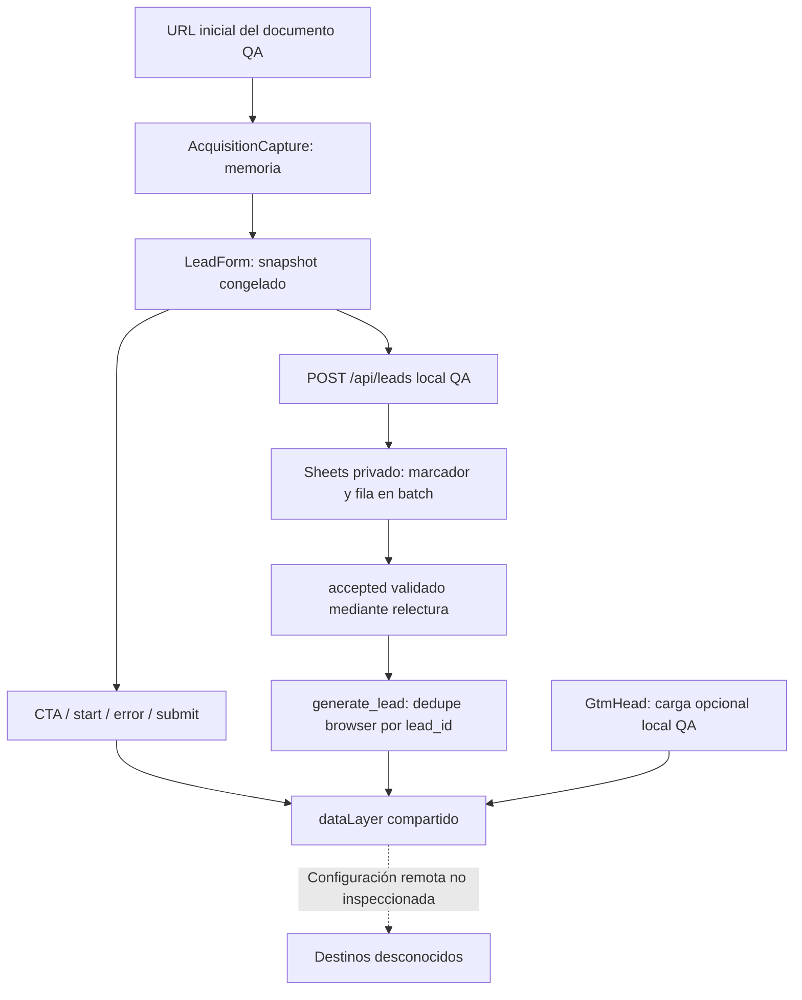

# Foundation de medición — auditoría del repositorio

Fecha: 21/10/2026, America/Santiago. Auditoría READ-ONLY de implementación; las únicas escrituras autorizadas son este documento y `implementation-status.md`. Sin configuración externa, navegación web, requests a proveedores, lectura de credenciales, despliegue ni cambios funcionales.

## Resumen ejecutivo

Existe una foundation local/QA reutilizable: contrato de cinco eventos de aplicación, `dataLayer` único, validación compartida, formulario de dos pasos, recepción Sheets server-only, idempotencia por `submission_id`, atribución congelada y deduplicación browser por `lead_id`. No constituye Full-Stack Tracking operativo. El código no acredita recepción GA4, conversiones Ads, Pixel/CAPI ni Clarity. La configuración del contenedor remoto es desconocida para esta auditoría.

La ampliación requiere primero resolver consentimiento, tratamiento de PII y alcance. El contrato QA permite contacto en `generate_lead.user_data`, mientras GTM puede cargarse en el mismo documento. El mapper local excluye contacto, pero no está conectado a un transporte GA4 de la aplicación ni demuestra el mapping del contenedor remoto. No se ha observado una fuga en esta auditoría; sí una superficie de exposición que bloquea ampliar destinos sin resolverla.

Full-Stack se evalúa aquí como captación confiable + contexto permitido + eventos browser + entrega server-side durable cuando se apruebe + deduplicación y reconciliación por destino. Tener un endpoint que guarda leads no implementa CAPI. Full-Stack no obliga a instalar sGTM, CRM ni GA4 Measurement Protocol.

## Fuentes, alcance y trazabilidad

Base: working tree actual, HEAD `d7f3aa9a9c8002c4762de039be89bd8bfe2680e9`. Hay numerosos cambios previos y archivos sin seguimiento, incluidos measurement y acquisition; el HEAD solo no reproduce lo auditado. No se creó commit ni se alteraron esos cambios.

Se revisaron `AGENTS.md`, `docs/decisions.md`, `docs/handoff-review.md`, strategy/product/wireframe/content/design/technical/measurement, `acceptance.md`, revisiones de measurement/acquisition/GTM y evidencia existente. El registro de decisiones adopta expresamente Sheets, `submission_id`, dos pasos y medición local/QA; las propuestas históricas de PostgreSQL/jobs/`request_id` no se reintroducen. No se reabren stack ni copy aprobado.

Reconciliación de fuentes:

| Referencia | Lectura vigente y efecto |
| --- | --- |
| `docs/decisions.md:228-256` | Sheets sustituye PostgreSQL en este flujo; lead confirmado antes de éxito; sin dispatcher ni scheduler de esta fase. |
| `docs/decisions.md:29-56` | Cinco eventos, `page_view` automática futura, excepción de PII QA, adquisición por documento; consentimiento diferido. |
| `docs/decisions.md:15-27` | GTM autorizado únicamente local/QA; corrección explícita React/HMR adopta efecto DOM en HEAD tras hidratación. `beforeInteractive` de otros párrafos es histórico. |
| `acceptance.md:15-38` | Enmiendas explícitas sustituyen manual pageview, `measurement_version` y adquisición histórica; no cierran CO-* ni producción. |
| `docs/measurement.md:270`, `acceptance.md:194` | Session replay/autocapture excluidos del MVP. Evaluar Clarity no aprueba su instalación ni sus finalidades. |
| `docs/handoff-review.md: H-07/H-08/H-09/H-21` | Consentimiento/revocación/destinos pendientes; publicidad y CAPI son extensiones. Esta solicitud autoriza auditoría y propuesta. |

Comparación SHA-256 con `docs/source-manifest.json` (snapshot 10/10): strategy, product, wireframe y design coinciden; content, technical y measurement difieren. Son cambios previos a esta auditoría, con actualizaciones incrementales registradas; el manifiesto no describe íntegramente el working tree actual. No se lo actualiza ni se considera esa diferencia una nueva aprobación.

| Fuente que difiere | SHA-256 actual |
| --- | --- |
| `docs/content.md` | `e8b78cd437ce90f975e6c79cf5ed545717f6a83e2b97aeb6c2dbf3abcca67aed` |
| `docs/technical.md` | `f330b97603dd4feb2c7cade630dcba9cf1a6a83a68c6c993068d46c9c587dcb7` |
| `docs/measurement.md` | `8e750ceb4d3439a93bbf483ac7beb45289aaf2818321f2f3091a7c3a1e4840ce` |

## Arquitectura observada



Puntos de control:

- `src/app/layout.tsx:28-41`: monta bootstrap de medición solo development + `NEXT_PUBLIC_WEB_MEASUREMENT_QA_ENABLED=true`; adquisición solo development + `LEAD_SHEETS_QA_ENABLED=true`. Los gates son independientes, no representan consentimiento.
- `src/lib/measurement/runtime.ts:8-38,79-96`: inicializa si no existe, exige array, centraliza `push`, valida schema, captura excepciones. Singleton `window.__analyticsJCMeasurementQA` conserva sets por documento entre consumidores/remount/SPA. No consulta CMP ni guarda preferencias.
- `src/lib/measurement/gtm.ts:9-40` y `src/components/measurement/GtmHead.tsx:6`: loader requiere development, siteEnv local o ausente, flags QA e ID válido; guard hostname loopback, dedupe de nodos, instalación DOM HEAD. No configura Google tag ni consiente destinos. Producción excluida por código; valores activos de `.env.local` no se inspeccionaron.
- `next.config.ts`: bloquea siteEnv distinto de local y `NEXT_PUBLIC_MEASUREMENT_ENABLED=true`; sin CSP específica implementada. `.env.example` tiene nombres de configuración, no prueba de cuentas provisionadas. Campos heredados Supabase/email/jobs no prueban integraciones.
- `package.json`: Next 16.4.0, React 19.3.0, Zod 4.6.5, Node 22.17.0/npm 10.9.2 declarados; npm y lockfile existentes. No SDK Meta/Clarity ni transporte publicitario en `src`. Son versiones observadas, sin verificación online de soporte vigente.

## Inventario de eventos y triggers de aplicación

Contrato: `src/lib/measurement/events.ts:5-26`; emisor único: `runtime.ts:26-38`. Todos los eventos de aplicación incluyen `page_type: 'home'`. No incluyen `measurement_version`, `submission_id`, GA IDs ni click IDs. Las claves específicas no aplicables se limpian a `null` antes de cada push (`runtime.ts:6`); el mapper de referencia omite null y `user_data` (`events.ts:29-34`). La limpieza no elimina entradas históricas del array ni impide lectura por terceros.

| Evento | Parámetros específicos | Trigger y punto de emisión |
| --- | --- | --- |
| `click_to_action` navegación | `cta_id=request_diagnosis`, `cta_location=header/hero/solution/experience`, `target_id=diagnostico` | `DiagnosisActionLink.tsx:8-14`; llamada desde HeaderNavigation, Hero, SolutionServices y Experience. Click primario/teclado, sin modificadores/defaultPrevented; filtra detail >= 2. |
| `click_to_action` Continuar | `cta_id=continue_diagnosis`, `cta_location=form_step_1`, `target_id=diagnosis_step_2`, `form_id=diagnosis_request` | `LeadForm.tsx:83`, únicamente tras Step1 válido. Volver y continuar válidamente constituye otra activación; no conversión. |
| `form_start` | `form_id=diagnosis_request` | `LeadForm.tsx:59-61,94`: edición mediante `edit`, fallback antes del POST válido. Set por form_id/documento, no por paso/retry; foco solo no emite. |
| `form_error` | `form_id`, `error_type`, `field_name`, `error_code` | `LeadForm.tsx:78,106,117`; resumen de validación cliente, 422 o recepción incierta/recuperable. Builders en `events.ts:36-54`; sin eco de valores. |
| `form_submit` | `form_id`, `attempt_type=initial/retry` | `LeadForm.tsx:94-97`, justo antes de cada POST válido, incluido reintento manual. No se emite por Continuar. |
| `generate_lead` | `form_id`, `lead_type=diagnosis_request`, `lead_id` UUID, `company_type`, `monthly_ad_spend`, `user_data` restringido | `LeadForm.tsx:103-105` → `events.ts:56-65`: HTTP 200/201, accepted estricto de submission activa y contacto válido. Set por lead_id/documento. |

`user_data` contiene email, phone_number y address.first_name/last_name: PII sin hash, excepción local/QA explícita; nunca autorizada para GA4 por esa excepción. `company_type` enum `lead_business/agency/other`; gasto enum `under_2000_usd/2000_5000_usd/over_5000_usd`; no es revenue, no genera value/currency.

Catálogos `form_error`: error_type `validation/server/reception`; field_name ocho campos actuales o `multiple/none`; error_code `required/invalid_format/invalid_option/too_long/multiple_validation_errors/server_validation/recoverable_error/unconfirmed_reception`. `mobile_bar` está admitido por schema, pero no tiene componente emisor encontrado. No se hallan triggers GTM exportados/versionados en el repositorio: los anteriores son triggers de aplicación, no configuración de plataforma acreditada.

Evento técnico adicional: bootstrap GTM empuja `gtm.start` y `event: 'gtm.js'` (`gtm.ts:21-25`), fuera del contrato de eventos de negocio. El bridge GA get usa entradas `arguments`, no nuevos eventos de negocio. Entradas que pueda añadir el contenedor externo no fueron inspeccionadas.

`page_view` no se emite desde aplicación. Su automatización Google Tag/GA4 es decisión adoptada, con una por pathname y ninguna por hash como objetivo pendiente de QA. No añadir manual pageview ni `site_page_view` para completar esta auditoría. `service_view` y `faq_interaction` tampoco existen en el contrato vigente.

## Formulario, API e identidad

- `src/lib/lead/schema.ts:5-33`: seis obligatorios Step1 (nombre, apellido, email, teléfono, empresa, tipo), inversión obligatoria Step2 y problema opcional. Ocho campos actuales; la regla antigua cinco obligatorios/dos opcionales está sustituida por decisión explícita del flujo Sheets. País del teléfono es UI, no dirección ni dimensión analítica.
- `LeadForm.tsx:27-35,49`: UUID `submission_id` creado perezosamente en primer edit/submit, estable durante esa instancia y sus pasos/retries. No se deduplica por email. No existe `request_id` operativo en el contrato actual ni `event_id` Meta.
- `LeadForm.tsx:84-118`: `inFlight` evita envío paralelo en la instancia; primer POST congela JSON de contacto, adquisición y GA opcional. Timeout cliente 15 s; no retry automático. Recepción incierta conserva bloqueo y payload. Un 422 no precedido de incertidumbre permite corregir con la misma llave y vuelve a congelar; replay aceptado no actualiza contexto.
- `src/app/api/leads/route.ts:9-43`: POST Node same-origin, solo QA no producción, Origin http loopback y Host coincidentes; application/json, máximo 16 KiB leído por stream y Zod estricto. 201 nuevo, 200 replay, 409 conflicto, 422 validación; errores saneados, no logs de body. No rate limit durable ni antispam público.
- `src/lib/server/lead-store.ts:25-86`: genera lead_id y timestamps servidor; batch único con namedRange estable derivado de submission y appendCells stringValue. Ante conflicto/error de escritura, reconcilia por lectura; nunca segundo append ciego. Relee identidad antes de accepted; mismo ID/contacto distinto da conflicto. Marcador + fila son mecanismo idempotente, no outbox.
- `src/lib/lead/contract.ts:14-31`: éxito requiere status accepted, UUIDs, accepted_at ISO, replayed boolean, HTTP 200/201 y submission coincidente. 202/malformed/otra submission no confirman. Timeout no prueba fracaso. generate_lead se intenta tras esa comprobación.
- `src/lib/server/sheets.ts`: credencial externa al repo leída server-only, token OAuth cacheado y requests Sheets con timeout 8 s, sin mensajes crudos del proveedor. No se ejecutó acceso a Sheets ahora.

Límites: recarga/desmontaje real del formulario pierde UUID/contacto/payload; documento nuevo pierde dedupe analytics. No hay garantía entre dispositivos/recargas. Borrado/edición manual de fila o marcador rompe integridad; backup CSV solo no conserva marcador. Cada persistencia lee todas las filas A:AJ: cuotas, escala y operación están pendientes. No hay job/dispatcher, ni entrega server-side vinculada atómicamente al accepted.

## Adquisición y gobierno de persistencia

| Capa | Estado observado y evidencia |
| --- | --- |
| Captura | `AcquisitionCapture.tsx:7-11` y `acquisition.ts:48-70`: primer href/referrer capturado en efecto, singleton de módulo durante documento. No cookie, localStorage ni sessionStorage. Momento posterior a hidratación; cambios previos al efecto no están cubiertos por una captura SSR. |
| Campos | Cinco UTMs, gclid/gbraid/wbraid, landing_page y referrer. Sin fbclid/msclkid/fbp/fbc capturados por este módulo. |
| Saneamiento | `acquisition.ts:7-61`: UTM dinámicas <=100 unidades UTF-16, NFC/trim, caracteres restringidos/defensas PII; click IDs <=512, preservar case/valor o descartar. Parámetros repetidos omitidos. Landing solo `/` o `/privacidad`; referrer solo origins example.org/example.com. No catálogo cerrado de valores UTM. |
| Asociación | `LeadForm.tsx:88-92`: snapshot anterior a GA get y JSON congelado; cambio query/hash/SPA no cambia first landing del documento ni payload de retry. No representa first touch histórico, sesión GA4 ni last touch. |
| Backend | `lead-store.ts:25-31`: valida otra vez, excluye coincidencias con contacto, escribe columnas planas existentes. Replay devuelve fila previa sin sustituir adquisición/GA. |
| Gobierno | Excepción local adoptada en decisions. Sin persistencia entre documentos, TTL, CMP ni política de borrado operativa final. Los 30/180 días propuestos no están adoptados como implementación. Retención Sheets no desaparece al recargar navegador. |

La sanitización de adquisición no limpia `window.location` ni configura page_location/page_referrer del Google tag. Por tanto no demuestra que un tag automático no lea query/referrer crudos. La defensa PII tampoco detecta universalmente nombres arbitrarios en campañas.

GA privado: `runtime.ts:40-72,93-96` permite get client_id/session_id solo si measurementId coincide con readyId; timeout total 500 ms, sin cookie parsing ni ID inventado. `notifyGoogleTagReady` no tiene caller de integración hallado en `src`; el mapper `ga4Parameters` solo tiene consumidores en tests. La readiness real y los IDs reales siguen NOT VALIDATED. Backend sanea formato, no verifica procedencia/permiso de IDs; aceptable como límite QA, insuficiente para exportación productiva.

## Evidencia y límites

Prueba actual AUD-UNIT-01 PASS: Windows/PowerShell, Node v22.17.0, npm 10.9.2, 31 tests/0 fallos, exit 0:

```powershell
node --conditions=react-server --experimental-strip-types --test tests/acquisition.test.mjs tests/lead-contract.test.mjs tests/lead-draft.test.mjs tests/measurement.test.mjs tests/gtm.test.mjs tests/phone-continue.test.mjs
```

Distribución: acquisition 7, GTM 4, lead-contract 3, lead-draft 3, measurement 10, phone-continue 4. Funciones puras/builders y VM/hosts mock; no invocan persistLead ni proveedores. Cubren accepted, allowlists, dedupe, gates, timeout mock GA y estructura batch. No prueban concurrencia Sheets real ni firing externo. Warnings Node experimental/type-less presentes, sin fallo.

Evidencia histórica consultada, no reejecutada: `docs/evidence/lead-sheets/checks.md` (19/10, concurrencia/replay/timeout real QA); `docs/evidence/measurement/checks.md` (20/10, browser local y Sheets); `docs/gtm-head-review.md` y referencia a `docs/evidence/gtm-head/browser-head-effect.json` (21/10, HEAD/HMR). Los bloques históricos anteriores dentro de esas revisiones conservan límites y fallos corregidos; no equivalen a estado actual de proveedores.

No se inició Next/dev/browser para evitar cargar GTM o transferir contacto. No se ejecutaron scripts de integración, setup, seguridad con credenciales o QA Sheets. Build/typecheck/lint, Network, Tag Assistant, GA4 DebugView, Ads/Meta/Clarity, producción y campo: NOT VALIDATED en esta auditoría. Ningún PASS local cierra M-02/M-03/M-08/M-09/CO-*/PR-* globales. Riesgos, decisiones y pruebas propuestas: [implementation-status.md](implementation-status.md).
