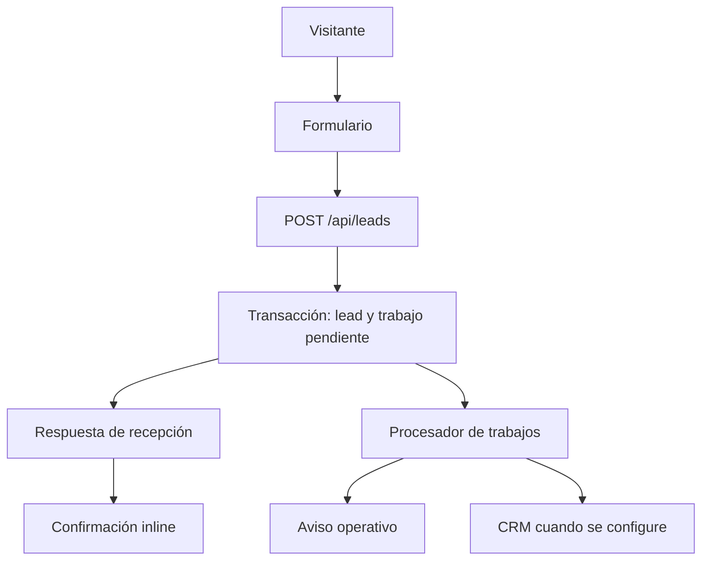

# Technical Specification

25/10/2026: GA identifiers privados pasan de gtag get a analytics_identity_ready GTM (decisions.md). Observación dataLayer histórica/futura, par válido atómico en memoria y snapshot sin await al POST. Payload ga.client_id/session_id y mapping a columnas existentes sin cambio; sin identidad se usa contexto opcional{} sin espera de500ms. No cambia dedupe/idempotencia/estado de recepción/contratos públicos.

Actualización23/10/2026: solicitud explícita de José y `next upgrade --agent=security` adoptan Next.js16.4.3 exacto (antes16.4.0), npm/lockfile y política experimental.agentUpgrade=security. Sin migración mayor ni Future Defaults. Evidencia y límites en next-security-review.md; no habilita producción ni altera contratos funcionales.

Actualización Web Measurement20/10/2026: decisions.md y web-measurement-review.md adoptan instrumentación local/QA con page_view automático futuro, sin measurement_version y con user_data restringido EXCLUIDO del mapper GA4. GA get opcional máximo500ms; POST admite ga privado saneado y congelado con submission, mapeado a columnas Sheets existentes. Sin loader/destinos externos activos. Las referencias siguientes a Supabase/job/request_id y formulario anterior son históricas donde decisions.md ya adoptó Sheets/submission_id/dos pasos; no se reintroducen. No se habilita producción ni consentimiento ficticio.

Actualización 10/10/2026: decisiones confirmadas y alcance en `decisions.md`. La confirmación es parcial; no convierte otros pendientes en aprobaciones ni acredita una implementación.

Proyecto: AnalyticsXXXXX — José Cubillo · Digital Analytics & Tracking.
Versión: 1.0, 7 de octubre de 2026 (America/Santiago).
Estado: stack base confirmado por José el 10/10/2026; contratos y pendientes restantes conservan su estado indicado. No es una web implementada.

Fuentes de producto leídas: `strategy.md` (6/10), `product.md` y `wireframe.md` (6/10), `content.md` y `design.md` (7/10). Preservar sus rutas, secciones, copy, campos y tokens. `product.md`, `wireframe.md` y `design.md` se identifican como propuestas v1; este documento no convierte su estado en aprobación. Usar `content.md` para texto, arquitectura UX para comportamiento y `design.md` para presentación. Ante un conflicto comercial, detener solo la parte afectada y documentarlo; no inventar una decisión. Este archivo gobierna funcionamiento técnico; `measurement.md`, medición.

## Stack

### Evaluación y elección confirmada del stack base

| Decisión real | Alternativa | Evaluación |
| --- | --- | --- |
| Framework | Astro con endpoint / Next.js App Router | Astro es suficiente para contenido estático. Se confirma Next.js porque mantiene React, validación, endpoint y futuras integraciones en un repositorio. No usar sus capacidades dinámicas en contenido que no las necesita. |
| Backend de captación | Servicio de formularios externo / endpoint propio | Un servicio reduciría código, pero debe demostrar idempotencia, persistencia y acceso a adquisición. Endpoint propio para un contrato explícito y trazabilidad verificable. |
| Primer destino | CRM único como receptor / registro persistente independiente | CRM aún no elegido. Registro persistente permite confirmar recepción y operar manualmente sin depender de una sincronización. |
| Hosting | Vercel / plataforma Node compatible | Vercel confirmado como hosting previsto por integración y previews. La aplicación debe ser portable a Node; no usar funciones exclusivas sin necesidad. Costos, plan comercial y región se verifican al contratar. |

Stack base confirmado: Next.js App Router + React + TypeScript strict, CSS Modules y variables CSS del diseño, Zod para contratos, PostgreSQL gestionado en Supabase para leads y trabajos pendientes, GTM para GA4, y proveedor de email transaccional detrás de un adaptador. No cerrar marca de CRM/email/CMP sin configuración operativa. No introducir CMS, Redux, React Query, ORM, framework de animación, servidor GTM ni microservicios en v1.

Usar versión estable y con soporte de cada dependencia al iniciar implementación; verificar requisitos de Node y hosting, fijar versiones exactas y lockfile. No copiar versiones supuestas de este documento. Un hosting exclusivamente estático no ejecuta `/api/leads`: requiere un backend separado y cambiaría esta elección.

## Architecture

Contenido comercial prerenderizado. Interactividad localizada. API same-origin bajo runtime Node. Base de datos privada; navegador sin acceso directo.



La transacción confirmada es la fuente de verdad de recepción. El frontend puede confirmar antes de la notificación o sincronización. Es un lead recibido, no cualificado. Analytics no condiciona ninguna operación comercial.

Rutas: `/`, `/privacidad`, 404 simple. Rutas técnicas: `POST /api/leads`; endpoint interno protegido para procesar trabajos si el hosting usa scheduler HTTP. No `/gracias`, calendario, páginas de servicios, administración pública ni portal cliente.

Anclas en orden: `inicio`, `problema`, `solucion`, `agencias`, `proceso`, `experiencia`, `preguntas`, `diagnostico`. Mantener header no fijo. Navegación: Solución, Proceso, Experiencia. CTA a `#diagnostico`; confirmación inline. FAQ con respuestas visibles, sin acordeón.

## Project Structure

Estructura inicial; no crear directorios vacíos de futuras funciones:

```text
src/
  app/
    layout.tsx
    page.tsx
    privacidad/page.tsx
    not-found.tsx
    robots.ts
    sitemap.ts
    api/leads/route.ts
    api/internal/jobs/route.ts
  components/
    layout/{Header,MobileMenu,Footer,Container}.tsx
    sections/{Hero,Problem,Solution,Agencies,Process,Experience,FAQ,Diagnosis}.tsx
    lead/{LeadForm,Field,FormFeedback}.tsx
    measurement/{ConsentControls,MeasurementProvider}.tsx
    MobileDiagnosisCTA.tsx
    MeasurementJourney.tsx
  content/site.ts
  styles/{tokens,globals}.css
  lib/
    lead/{schema,types}.ts
    server/{db,create-lead,rate-limit,jobs,notifications,crm}.ts
    measurement/{events,consent,acquisition,identifiers,sanitize}.ts
supabase/migrations/
tests/{lead-api,consent,measurement,lead-flow}.*
public/{fonts,images}/
docs/{technical,measurement}.md
.env.example
```

El árbol representa rutas y módulos, no sintaxis literal para generar nombres con llaves. Marcar módulos privados `server-only`. Importar tipos compartidos sin arrastrar secretos a cliente. Mantener SQL versionado y contratos únicos.

## Components

| Componente | Renderizado | Responsabilidad |
| --- | --- | --- |
| Layout, páginas, contenido y secciones | Server Components | HTML semántico, metadata, copy completo, diagrama conceptual |
| MobileMenu | Client Component pequeño | Expandir panel en flujo, Escape, cierre al navegar, foco |
| MobileDiagnosisCTA | Client | IntersectionObserver y foco; ocultar con menú abierto, formulario/éxito visible o campo enfocado; safe area |
| LeadForm | Client | Validación, estados, request ID, POST, confirmación e instrumentación |
| ConsentControls | Client | Decisiones separadas, preferencias persistentes y revocación |
| MeasurementProvider | Client | Carga condicional de GTM y API tipada de eventos; nunca envolver toda la página en lógica cliente innecesaria |
| MeasurementJourney | Server | HTML/CSS y SVG ligero, texto equivalente; usar Campaña → Lead → CRM → Oportunidad → Venta, sin inventar dashboards |

CSS Modules por componente y tokens compartidos. Inter local WOFF2 con `next/font/local`, peso variable 400–600. Lucide con imports individuales solo donde el diseño lo requiere. Los CTA son enlaces reales; el botón de envío es una acción. No instrumentar por texto visible ni clases CSS.

## Forms

Un formulario de una pantalla; `form_id = diagnosis_request`. Copy y errores de `content.md`, sin nuevos campos comerciales.

| Payload | Campo | Requerido | Validación técnica propuesta |
| --- | --- | --- | --- |
| `name` | Nombre | Sí | Trim, 1–120 caracteres; admitir Unicode y nombres diversos |
| `email` | Email de contacto | Sí | Trim, email válido, máximo 254; aceptar email personal |
| `website` | Sitio empresa/agencia | Sí | Máximo 2048; admitir dominio sin protocolo añadiendo HTTPS; URL HTTP/HTTPS con hostname válido |
| `organization_type` | Tipo organización | Sí | `lead_business`, `agency`, `other`; placeholder no válido |
| `ad_spend_context` | Inversión aproximada | No | Texto, máximo 200; no derivar monto/rango/moneda automáticamente |
| `crm_context` | CRM utilizado | No | Texto, máximo 120; no imponer catálogo |
| `problem` | Problema | Sí | Trim, 1–2000; no mínimo arbitrario ni interpretación AI |

Límites son decisiones técnicas propuestas, no criterios de encaje. Revalidar en servidor, límites de cuerpo y propiedades conocidas. No resolver ni visitar la URL enviada: evitar SSRF. No admitir `javascript:`, `data:`, credenciales en URL ni contenido HTML ejecutable. Guardar texto, escapar al presentar. No restringir el formulario a correo corporativo.

`website` usa input de texto con `inputmode=url` para aceptar dominios; email con autocomplete email y nombre con autocomplete name. Labels persistentes. Validar al submit; corregir al editar tras primer error. Native semantics más Zod; no mezclar globos nativos y errores inline redundantes. Formulario con JS se anuncia accesiblemente; sin JS, contenido y anclas siguen disponibles y se presenta el canal de soporte real en `noscript`. El envío sin JS no es requisito de v1 y debe constar como limitación, sin botón que aparente funcionar.

Máquina de estados: `idle → editing → validating → submitting → success | validation_error | reception_error | uncertain`. `uncertain` es timeout/pérdida de respuesta: conservar entradas y reintentar misma operación. No afirmar fracaso definitivo si pudo persistirse.

- Deshabilitar submit solo durante petición activa, no por campos vacíos. Anunciar estado, foco al primer error, `aria-invalid` y `aria-describedby`.
- Cliente espera hasta 10 segundos; duración del servidor y timeout del proveedor se ajustan al hosting. Un timeout no invalida un commit previo.
- Generar UUID `request_id` al primer submit válido. Conservarlo en memoria durante el intento y sus reintentos. No regenerarlo por timeout. Bloquear edición del payload mientras se verifica un intento incierto; ofrecer reintento explícito, sin nuevas vías comerciales.
- Tras error explícito previo a aceptación, si el usuario cambia campos puede comenzar nueva operación con nuevo request ID. Una segunda solicitud intencional no se deduplica por email.
- Guardar valores personales solo en memoria del formulario; no local/sessionStorage, URL, dataLayer ni logs. Éxito elimina entradas y reemplaza el formulario por confirmación del copy.
- Un request incierto sobrevive mientras la página está abierta; recargar puede perder el ID. No afirmar deduplicación entre dispositivos o recargas. Mejoras futuras requieren una política de almacenamiento técnico específica.

## Backend

### Contrato HTTP

`POST /api/leads`, JSON, `Cache-Control: no-store`, sin CORS abierto.

```ts
interface LeadRequest {
  schema_version: '1';
  request_id: string; // UUID
  form_id: 'diagnosis_request';
  contact: {
    name: string; email: string; website: string;
    organization_type: 'lead_business' | 'agency' | 'other';
    ad_spend_context?: string; crm_context?: string; problem: string;
  };
  context: {
    attribution?: AllowedAcquisition; // definido en measurement.md
    ga?: { client_id?: string; session_id?: string; collected_at: string };
    consent: ConsentSnapshot;
    landing_path: '/' | '/privacidad';
    last_cta_location?: 'header' | 'hero' | 'solution' | 'experience' | 'mobile_bar';
  };
}
interface LeadAccepted {
  status: 'accepted';
  lead_id: string; // UUID del servidor
  accepted_at: string; // UTC ISO 8601
  replayed: boolean;
}
```

Contexto e IDs del cliente no son autenticación ni datos confiables: validar y sanitizar; valores ausentes permitidos. ConsentSnapshot incluye versión, estados y momento de decisión o ausencia explícita; el servidor descarta contexto no permitido. No enviar copia de contact en respuesta.

| HTTP | Significado y UI |
| --- | --- |
| 201 | Nuevo lead persistido; éxito |
| 200 | Replay de misma solicitud/payload; mismo lead y éxito sin duplicar |
| 422 | Campos inválidos con códigos por campo; no eco de valores |
| 409 | Mismo request ID con payload comercial distinto; no confirmar ni insertar |
| 429 | Límite de abuso, Retry-After; conservar datos |
| 503 | Receptor no disponible, recepción no confirmada |

Respuesta de fallo: `{status:'error', code, field_errors?}` con catálogo cerrado, sin SQL, stack, claves, valores o email. Cuerpo máximo propuesto 16 KiB; error 413 para excedentes. Error 403 para origen inválido y 415 para tipo incorrecto. Codex debe cubrir también estas respuestas.

### Persistencia e idempotencia

PostgreSQL con `leads`, `lead_jobs` y `lead_status_history`. Hacer un único procedimiento transaccional (RPC server-only) que inserta lead y trabajo de aviso; no dos llamadas independientes. Unique index en `request_id`; UUID lead_id generado en servidor. Guardar huella HMAC del payload de contacto normalizado para comparar reintentos; no comparar adquisición/GA, que puede cambiar mientras carga una etiqueta. Comparación ocurre antes de modificar contexto; replay nunca sobrescribe contacto ni reabre trabajo completado. El digest no se envía a analítica ni se usa como ID de persona.

Dos solicitudes simultáneas con misma llave deben obtener mismo registro o 409 si contacto difiere. Un fallo al insertar trabajo revierte lead. Si DB falla no mostrar éxito. Nunca deduplicar comercialmente por email o por GA ID.

Campos `leads`: lead_id, request_id, contact restringido, payload_digest, created_at del servidor, schema_version, form_id, contexto saneado permitido, consentimiento y versión, estado comercial inicial `received`, crm_record_id nullable. GA/client acquisition nullable. No guardar IP/UA en lead para enriquecer publicidad por defecto.

`lead_jobs`: job_id, lead_id, destination, status (`pending/processing/succeeded/failed`), attempts, next_attempt_at, locked_until, provider_record_id, error_code, timestamps. Unique `(lead_id,destination)`. Claim de trabajos mediante transacción/lock con lease; recuperar lease vencido. Avisos/CRM se procesan mediante scheduler protegido y batch pequeño. No `setTimeout` ni promesas sin await después de responder: no son una cola durable en serverless.

### Operación mínima

Usar consola autenticada del proveedor de base de datos como bandeja privada inicial; José revisa leads y cambia estados manualmente. No construir admin UI. Notificación de email con ID y enlace autenticado al registro; evitar copiar problema completo en correo. En envío, proveedor debe soportar idempotencia o documentar posibles avisos duplicados; base de datos garantiza un lead, no entrega exactamente una vez en servicios externos.

Reintentos de notificación: propuesta 1 min, 5 min, 30 min, 2 h y 12 h; después `failed` y revisión manual. Scheduler según capacidad del plan; intervalos son mínimos, no SLA. Lanzamiento requiere aviso probado y revisión manual de jobs fallidos. Si CRM no existe, la tabla privada es el destino operativo, no simular una integración instalada.

## Deployment

Vercel + PostgreSQL Supabase confirmados como destino previsto y receptor. Seleccionar región, plan y tratamiento de datos antes de producción. No asumir gratuidad ni garantías de uptime.

Entornos separados: local, preview/staging y producción. Bases, GTM/GA y secretos separados; no leads reales ni conversiones de Ads en previews. Preview con autenticación, noindex y robots restringido; robots no protege datos. Dominio HTTPS, DNS y remitente de correo autenticado antes de lanzar.

Orden: lockfile → validación de variables → migraciones de staging → typecheck/lint/build → pruebas API y formulario → QA visual/consentimiento → migraciones de producción → release → smoke test con solicitud identificada como prueba y destinos de publicidad desactivados para ella. No probar con PII de terceros. Rollback de app a release previo; cambios SQL compatibles y backup/restore ensayado. Retención de backups coherente con borrado.

CI mínima: instalación reproducible, TypeScript, ESLint, build, tests críticos. Pruebas relevantes: validación backend, transacción, concurrencia/idempotencia, timeout+replay, fallo de email, consentimiento y ausencia de PII en requests analíticos. E2E en navegador para inválido, éxito, receptor caído y reintento. No tests que solo reflejen estilos o texto estático.

## SEO

Idioma `es`, contenido en español existente; no rutas regionales ni traducciones nuevas. Metadata por ruta con título/descripción basados en copy aprobado, canonical absoluto sin query/hash y Open Graph con imagen real autorizada. SITE_URL obligatorio en producción; no canonical a dominio placeholder. `robots.ts` y `sitemap.ts` solo rutas públicas implementadas; 404 con HTTP 404.

Un H1 por página. Contenido significativo en HTML inicial. No FAQ rich results, Organization con equipo ficticio, reviews, certificaciones ni schema de negocio con datos inventados. Person puede añadirse solo con información profesional publicable verificada. Preview no indexable.

## Performance

Objetivos de aceptación, no resultados medidos: LCP ≤2.5 s, INP ≤200 ms y CLS ≤0.1 al percentil 75 cuando haya datos de campo suficientes. En MVP bajo tráfico, reportar laboratorio separado del campo; Lighthouse no demuestra INP de usuarios.

- Prerenderizar páginas; no cookies/headers dinámicos en layout por necesidad de analytics. Preferencias leídas en cliente.
- Fuente local, dimensiones explícitas, sin background video ni imágenes innecesarias. SVG/HTML para recorrido, no biblioteca de gráficos.
- Solo componentes interactivos hidratados; imports de iconos individuales. Presupuesto orientativo de JS propio inicial ≤100 KiB gzip, excluyendo runtime y vendors; informar total real, no ocultar peso de GTM.
- GTM carga tras consentimiento y fuera del camino crítico. Evaluar con y sin consentimiento. Scripts o bloqueo de analytics nunca retrasan POST del formulario.
- Verificar móvil, CPU/red limitadas, layout shifts al mostrar barra y confirmación. Reservar espacio y respetar teclado/safe area.

## Accessibility

Objetivo WCAG 2.2 AA, sin afirmar certificación. Aplicar reglas de `design.md`: contraste 4.5:1 texto, 3:1 controles, targets 44×44, foco visible, reduced motion, forced-colors, sin overflow a 320 px ni zoom 200%.

Landmarks, skip link, orden de DOM igual al visual y títulos semánticos. Anclas enfocan encabezado de destino si se gestiona navegación JS; no romper link nativo. Menú no modal, sin focus trap. FAQ visible. Diagrama con texto equivalente.

Errores por campo y resumen; éxito `role=status` con foco en título si reemplaza formulario; no doble anuncio innecesario. Consentimiento accesible por teclado, rechazar tan accesible como aceptar. Validar recorrido con lector de pantalla y teclado además de auditoría automatizada. Barra móvil se oculta con cualquier campo enfocado.

## Security

Secretos solo backend. Tablas con RLS habilitado; sin políticas públicas para leads, jobs e historial; service role solo en módulo server-only (bypassa RLS, por lo que su exposición es crítica). Acceso humano con cuenta individual y MFA cuando disponible; no compartir exportaciones públicas.

Validar Origin contra allowlist del entorno, JSON content type, límites y schema. SameSite/Origin no sustituyen rate limiting. Rate limit persistente, no Map en proceso serverless: propuesta 5 intentos nuevos/10 min por HMAC temporal de IP con sal rotada y retención breve, permitiendo replays legítimos. Obtener IP solo de cabeceras confiables del hosting; no guardarla en logs generales. Honeypot accesible oculto fuera de tab order como ayuda, nunca éxito falso ni único filtro. CAPTCHA solo ante abuso real, tras evaluar proveedor/privacidad.

HTTPS, cookies Secure/SameSite y HttpOnly donde no necesite acceso JS. CSP primero report-only y luego enforced con dominios realmente usados por GTM/GA/CMP; no comodines globales ni `'unsafe-eval'`. Verificar scripts inline de Next y elegir hash/nonce soportado por versión: si nonce obliga render dinámico, documentar el costo antes de cambiar prerenderizado. Headers: nosniff, frame-ancestors, referrer policy restrictiva y permissions policy para capacidades no usadas. No capturar request bodies en logs/APM ni queries completas. Sanitizar mensajes de providers.

Scheduler con secreto, sin acceso anónimo; CRM webhooks futuros con firma/timestamp y protección de replay. No automatización AI con datos de solicitudes en v1. Revisar acceso, borrado y restauración de backup antes de producción.

## Environment Variables

| Variable | Exposición | Propósito |
| --- | --- | --- |
| `SITE_URL` | Servidor | Canonical y validación del dominio real |
| `NEXT_PUBLIC_SITE_ENV` | Pública | `local`, `preview`, `production` |
| `NEXT_PUBLIC_GTM_ID` | Pública | Contenedor del entorno; ID no secreto |
| `NEXT_PUBLIC_GA4_MEASUREMENT_ID` | Pública | Lectura de IDs tras consentimiento, sin segundo config |
| `NEXT_PUBLIC_MEASUREMENT_ENABLED` | Pública | Desactivación explícita en builds sin medición |
| `SUPABASE_URL` | Servidor | Endpoint DB; no acceso cliente requerido |
| `SUPABASE_SERVICE_ROLE_KEY` | Secreta | Persistencia privada y procesamiento |
| `IDEMPOTENCY_HMAC_SECRET` | Secreta | Digest de contacto para replay |
| `RATE_LIMIT_HMAC_SECRET` | Secreta | Llaves temporales contra abuso |
| `ALLOWED_ORIGINS` | Servidor | Orígenes admitidos en API |
| `JOB_SECRET` | Secreta | Invocación protegida del scheduler |
| `EMAIL_API_KEY`, `EMAIL_FROM`, `LEAD_NOTIFY_TO` | Servidor | Aviso operativo; proveedor elegido al configurar |
| `SUPPORT_EMAIL` | Renderizado público | Contacto real, reemplaza placeholder |
| `PRIVACY_POLICY_VERSION` | Servidor/pública en aviso | Vincular información mostrada y registro |
| `CRM_ENABLED` | Servidor | False hasta integración validada |
| `CRM_API_KEY`, `CRM_BASE_URL` | Secreta/servidor | Solo si hay CRM elegido; destino fijo allowlisted |

`.env.example` con nombres y valores vacíos, nunca secretos. Production debe fallar su validación si falta DB, email, contacto real, dominio o versión de privacidad; GTM puede desactivarse conscientemente sin inutilizar el formulario. MP/CAPI/Ads no requieren variables aún: añadirlas cuando se implemente la fase correspondiente. Cambios `NEXT_PUBLIC_*` requieren nuevo build.

## Dependencies

Runtime mínimo: next, react, react-dom, zod, server-only, cliente Supabase server-only y lucide-react si se usa. Dev: TypeScript, ESLint compatible, Vitest para contratos/API y Playwright con axe para flujos críticos. Email por SDK mínimo o fetch server-side según proveedor. Usar gestor único y lockfile. CSS nativo evita añadir Tailwind solo por hábito. Una CMP puede añadir su dependencia después de elegirla, con carga controlada.

Fuentes oficiales verificadas para decisiones técnicas (consultadas 7/10/2026; reglas de este documento son decisiones del proyecto, no transcripción):

- [Next.js Server/Client Components](https://nextjs.org/docs/app/getting-started/server-and-client-components).
- [Next.js Deployment](https://nextjs.org/docs/app/getting-started/deploying).
- [Next.js en Vercel](https://vercel.com/docs/frameworks/full-stack/nextjs).
- [Supabase RLS](https://supabase.com/docs/guides/database/postgres/row-level-security).
- [Google Consent Mode](https://developers.google.com/tag-platform/security/concepts/consent-mode).

## Technical Constraints

No cambiar producto, copy o UI para acomodar una librería. No nuevas rutas comerciales, formularios, checkboxes de marketing obligatorios, chatbots, precios, SLA, testimonios ni métricas ficticias. El email provisional autorizado solo sirve en revisión: nunca receptor operativo.

**Listo para implementar:** rutas, componentes, contratos, validación, idempotencia, registro persistente, estados y reglas de medición. **Pendiente operativo antes de producción:** dominio, plan/regiones/proveedores reales, credenciales, bandeja y responsable de revisión, remitente/soporte, contenido final de privacidad con retención/borrado, implementación y texto del control de consentimiento, evidencia publicable. CRM y publicidad offline pueden quedar desactivados sin bloquear captación real; no publicitar su instalación como completada.

Criterio de terminado: formulario conserva solicitudes confirmadas, reintentos no duplican lead, fallo del aviso no pierde datos, preferencias se respetan, PII no sale a analytics, todos los estados son accesibles, build y pruebas críticas pasan, copy/tokens/rutas coinciden y pendientes de producción están resueltos. Este documento no acredita pruebas ejecutadas de una web.

## Adopción QA Vercel — 25/10/2026

La preparación Preview solicitada en decisions.md extiende gates local a QA explícito; configuración operativa en qa-deployment.md. Sheets conserva batch atómico/reconciliación; no se introduce job, dispatcher ni storage nuevo. Credential JSON server-only, sin filesystem requerido en QA; Node runtime en /api/leads, maxDuration=60 para lecturas/OAuth/escritura/reconciliación (cliente15s conserva incertidumbre y retry). Producción continúa bloqueada.
